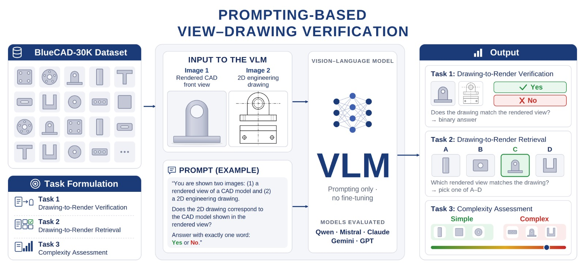

<h1 align="center">
Blueprint2CAD: Benchmarking Foundation Models on Engineering Drawing-to-CAD Render Correspondence
</h1>

<div align="center">

Alexander Valverde<sup>1</sup>,
Danny Xie-Li<sup>2</sup>,
Zhichao Wang<sup>1</sup>,
Marcos V. Conde<sup>3</sup>

</div>

<p align="center">
  <sup>1</sup>Novineer, Florida, USA
  <br>
  <sup>2</sup>Instituto Tecnológico de Costa Rica, San José, Costa Rica
  <br>
  <sup>3</sup>University of Würzburg, Würzburg, Germany
</p>

<p align="center">
  <a href="https://alexvalgui.github.io/blueprint2cad/paper.pdf"></a>
  <a href="https://huggingface.co/datasets/alex-novineer/blueprint2cad"></a>
  
  
  
</p>

---

<p align="center">
  
</p>

## Abstract

Engineering drawings specify mechanical parts through orthographic projections. Recognizing which part a drawing depicts underlies part search, design reuse, and digitization, yet no public benchmark measures whether vision models can do it. We introduce Blueprint2CAD, a benchmark for drawing-to-render correspondence: given an orthographic line drawing and a shaded render, usually from another viewpoint, decide whether they show the same part. Its data layer, BlueCAD-30K, applies an open drafting pipeline to 29,925 Zero-to-CAD models, adding view-aligned renders, clean and dimensioned drawings from six viewpoints, and surface-type metadata. Frozen encoders retrieve the matching part from a 10,000-model gallery with up to 65% Recall@1 when viewpoints are known but 43% when they are not, and the four encoders we test lie within six points of each other: viewpoint, not backbone, is the bottleneck. Six zero-shot vision-language models reach only 0.52–0.67 verification accuracy, with model-specific Yes/No biases that chain-of-thought shifts but does not remove; a quick LoRA fine-tuning on in-domain pairs improves verification accuracy by a few points but sharpens these biases and leaves the viewpoint failure intact.

## Summary

- **BlueCAD-30K**: 29,925 STEP models from Zero-to-CAD, each with six shaded renders and six clean and six dimensioned hidden-line drawings under a shared camera rig, plus B-rep surface-type metadata and model-level train / val / test splits. Hosted on [Hugging Face](https://huggingface.co/datasets/alex-novineer/blueprint2cad).
- **Frozen encoders** (DINOv3, SigLIP 2, RADIO, TIPSv2) retrieve drawings ↔ renders over a 10,000-model gallery. With known viewpoints the best reaches 65% R@1; without them 43%. A non-learned silhouette descriptor already reaches 49% aligned R@1.
- **Six zero-shot VLMs** (Claude Sonnet 5, Gemini 3.6 Flash, GPT-5.6 Luna, Mistral Small 3.2 24B, InternVL3.5 14B, Qwen3-VL 8B) score 0.52–0.67 on binary verification; each carries its own Yes/No prior, and top/bottom renders defeat every model.
- **LoRA on Qwen3-VL 8B** lifts verification from 0.670 to 0.685 but drops retrieval to chance and sharpens the No bias.

## Tasks

All inputs are pairs of 2D images: a line drawing and a render. Nothing is claimed about recovering 3D geometry.

| Task | Input | Question | Chance |
|---|---|---|:-:|
| Retrieval (VFMs) | 1 drawing, 10,000 renders | Which gallery model matches? Reported as R@k, MRR, median rank, view-agnostic and view-aligned | 0.01% R@1 |
| Task 1: Verification | front drawing + render from any view | Same part? `Yes` / `No` (also with dimensioned drawings and chain-of-thought) | 0.50 |
| Task 2: Retrieval | right-view drawing + 4 right-view renders | Which render matches? `A`–`D` | 0.25 |
| Task 3: Complexity probe | six renders | `Simple` or `Complex`, no criterion given; scored against surface-type class | 0.50 |

Task 1 prompt:

```text
You are shown a rendered view of a CAD model and a 2D engineering drawing.
The two images may show the part from different viewpoints.
Do they depict the same part? Answer with exactly one word: Yes or No.
```

## Results

**Frozen-backbone retrieval** (R@1 %, drawing → render, 10,000-model gallery). *Max* / *Mean* assume unknown viewpoints; *Al-max* / *Al-mean* use known viewpoints.

| Backbone | Max | Mean | Al-max | Al-mean | MRR (Al-mean) |
|---|:-:|:-:|:-:|:-:|:-:|
| Silhouette | 7.85 | 20.16 | 10.06 | 48.54 | 0.555 |
| DINOv3 | 29.10 | **43.11** | 34.67 | **65.14** | **0.728** |
| TIPSv2 | **34.39** | 34.65 | **38.58** | 64.65 | 0.724 |
| SigLIP2 | 29.52 | 38.07 | 33.54 | 64.15 | 0.714 |
| RADIO | 27.46 | 36.54 | 30.98 | 59.51 | 0.675 |

Fusing views one at a time (DINOv3, Al-mean) goes from 14.9 R@1 with *front* alone to 65.6 with five views; *top* and *bottom* are the strongest single views. Adding dimension annotations costs at most 7 R@1 points.

**VLM benchmark** (accuracy, n = 1000; bold = best zero-shot).

| Model | Task 1 | Task 1 + dim | Task 2 | Task 3 |
|---|:-:|:-:|:-:|:-:|
| Claude Sonnet 5 | 0.635 | 0.590 | 0.374 | 0.520 |
| Gemini 3.6 Flash | 0.654 | 0.670 | **0.690** | 0.562 |
| GPT-5.6 Luna | **0.670** | 0.654 | 0.637 | **0.676** |
| Mistral-S 3.2 24B | 0.534 | 0.524 | 0.274 | 0.521 |
| InternVL3.5 14B | 0.624 | 0.637 | 0.266 | 0.506 |
| Qwen3-VL 8B | 0.669 | **0.655** | 0.317 | 0.512 |
| Qwen3-VL 8B (LoRA) | 0.685 | 0.699 | 0.241 | 0.553 |

No pair among the four leading models differs significantly on Task 1. Claude and GPT-5.6 lean towards Yes, Gemini, Mistral and InternVL towards No; chain-of-thought moves each bias without correcting it (best CoT result +0.7 points). On Task 3 every model except GPT-5.6 answers *Simple* on 88–98% of a balanced set.

## Dataset

Every model goes through the same pipeline (`vfms/src/`):

1. **Filtering and complexity** (`geometry/`): a B-rep parser drops non-watertight or degenerate models and scores each one from seven normalized signals (freeform-face ratio, face count, non-planar ratio, surface-type entropy, inner loops, curved-edge ratio, sphericity). The 500 lowest and 500 highest scoring models form the VLM evaluation set (*simple* = prismatic, *complex* = freeform).
2. **Drawings** (`rendering/`): six canonical orthographic projections (front, back, left, right, top, bottom) with OpenCascade's exact hidden-line removal, stored as layered DXF and rasterized to 1024 × 1024 PNG. The dimensioned variant adds overall width and height.
3. **Renders**: Blender, same six camera axes, 1024 × 1024 with transparent background, so drawing and render correspond by construction.

Splits (by model identifier), the 1,000-model VLM evaluation set and the 10,000-model retrieval gallery are released with the data on [Hugging Face](https://huggingface.co/datasets/alex-novineer/blueprint2cad).

```text
BlueCAD30K/data/
  drawings/<id>/normal/<id>_{front,...,bottom}.png
  drawings/<id>/dim/<id>_{front,...,bottom}_dim.png
  renders/<id>/000.png ... 005.png  (+ transforms.json)
```

## Repository

```text
vfms/src/
  geometry/     STEP complexity scoring and simple/complex subset selection
  rendering/    HLR drawings (DXF), PNG rasterization, auto-dimensioning
  extractor/    multi-view feature extraction (CLIP, DINOv1/2/3, RADIO, SigLIP2,
                I-JEPA, SAM, SAM3, Depth Anything, TIPSv2)
  analysis/     retrieval experiments 1–3 and the silhouette baseline
vlms/src/
  benchmark/    Tasks 1–3 (prompts, item files, metrics, CLI, viewpoint breakdown)
  finetune/qwen LoRA training, evaluation and attribution for Qwen3-VL
```

## Usage

**Retrieval with a frozen encoder.** Extract one descriptor per view for each modality, then run the experiments.

```bash
cd vfms/src/extractor
python multiview_extract.py --dataset BlueCAD30K/data/drawings --output features/dinov3/drawings \
    --model-type dino-v3 --model-name facebook/dinov3-vitb16-pretrain-lvd1689m --num-views 6
python multiview_extract.py --dataset BlueCAD30K/data/renders  --output features/dinov3/renders \
    --model-type dino-v3 --model-name facebook/dinov3-vitb16-pretrain-lvd1689m --num-views 6

cd ../analysis
python experiment_1.py --feat features/dinov3 --ids ids.txt --key cls --name dinov3 --center  # Tab. 1
python experiment_2.py --feat features/dinov3 --ids ids.txt --key cls --name dinov3 --center  # view fusion
python experiment_3.py --feat features/dinov3 --ids ids.txt --key cls --name dinov3 --center  # dim ablation
python silhouette_baseline.py ...                                                             # non-learned baseline
```

**VLM benchmark.** The item files used in the paper are in `vlms/src/benchmark/items/`. Set `OPENAI_API_KEY`, `GEMINI_API_KEY` or `ANTHROPIC_API_KEY`, or point `--base-url` at any OpenAI-compatible endpoint; `--provider local` runs a Hugging Face checkpoint, optionally with a LoRA adapter.

```bash
cd vlms/src/benchmark
python run.py run --items-file items/task1_items.json --provider openai --model gpt-5.6-luna
python run.py run --items-file items/task1_items.json --provider gemini --model gemini-3.6-flash --cot
python run.py run --items-file items/task2_items.json --provider local --model Qwen/Qwen3-VL-8B-Instruct \
    --adapter runs/qwen3vl8b_lora_bluecad30k
```

Each run writes one JSON to `results/` with raw responses, parsed predictions, and metrics overall, by complexity class and by negative tier.

**Fine-tuning.** Paths and the prompt are in `vlms/src/finetune/qwen/config_qwen.py`.

```bash
cd vlms/src/finetune/qwen
python train_qwen.py                          # rank-16 LoRA on language model + vision encoder
python train_qwen.py --load-4bit --grad-ckpt  # QLoRA for a ~24 GB GPU
python eval_qwen.py --data data/test.jsonl --adapter runs/qwen3vl8b_lora_bluecad30k --out results/ft_8b.csv
```

`eval_qwen.py` reads the next-token log-probabilities of `Yes` / `No` in a single forward pass and reports forced-choice accuracy, ROC-AUC, best-threshold accuracy, ECE and d′, with breakdowns by negative type and render viewpoint.

## Limitations

- Drawings are clean orthographic projections from one procedural generator: no section views, GD&T, title blocks or scan artifacts.
- View-aligned scoring uses oracle viewpoint labels and is a diagnostic; the view-agnostic setting is the deployable one.
- Models are evaluated frozen or zero-shot, with a single small LoRA variant.
- *Simple* / *complex* follow B-rep surface type, not expert judgement of complexity.

## Citation

```bibtex
@inproceedings{valverde2027blueprint2cad,
  title     = {Blueprint2CAD: Benchmarking Foundation Models on Engineering Drawing-to-CAD Render Correspondence},
  author    = {Valverde, Alexander and Xie-Li, Danny and Wang, Zhichao and Conde, Marcos V.},
  booktitle = {Proceedings of the IEEE/CVF Winter Conference on Applications of Computer Vision (WACV) Workshops},
  year      = {2027}
}
```

## Acknowledgements

Built on Zero-to-CAD, OpenCascade (via [pythonocc](https://github.com/tpaviot/pythonocc-core)), [ezdxf](https://github.com/mozman/ezdxf), Blender, DINOv3, SigLIP 2, RADIO, TIPSv2, [Qwen3-VL](https://arxiv.org/abs/2511.21631) and [LoRA](https://arxiv.org/abs/2106.09685). Data is released under CC BY 4.0 and code under Apache 2.0.
